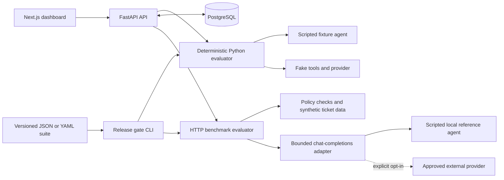

# Architecture

AgentProof has two evaluation paths. The V1 evaluator runs scripted fixtures in-process against a versioned suite and fake provider. The HTTP evaluator exchanges chat-completions messages with the open-source reference agent or an operator-approved provider, tests proposed calls before any synthetic tool result, and independently scores a final answer. FastAPI scopes stored results to authenticated workspaces. The CLI can run the V1 gate independently or invoke the HTTP evaluator against its configured agent.

## HTTP evaluation flow

An HTTP run selects a versioned benchmark and an agent. The API and dashboard select from the installed local reference agents. An operator can also expose the external model to one approved workspace or use it through the CLI. The evaluator asks the adapter for each model response, checks proposed calls against a local policy, and supplies only synthetic tool results. Final answers are scored against labeled expected outputs. Policy and task measurements both contribute evidence, and the gate reports critical failures.

A benchmark digest binds a run to the exact case data. Each stored run includes its reference or provider evidence class, agent and model identity, suite, adapter and evaluator versions, and correlation ID. PostgreSQL stores HTTP run summaries and case results in `agent_runs` and `agent_run_results`, introduced by the second SQL migration. V1 suites, runs, and replay provenance stay in their original tables. Compare HTTP runs on matching dataset digests and suite versions.

## Scope and assumptions

The initial repository at `8c4758d` contained a README and Apache 2.0 license. The MVP assumes a developer-controlled local instance of PostgreSQL, an isolated Compose stack, and bounded fixture input. Its workspace tokens support local development and API authorization tests. Use the bundled fixture suite to reproduce the examples.

The V1 evaluation is bounded by virtual limits. Its simulated worker interruption is an outcome in the evaluator. The HTTP path uses a bounded tool-decision loop and transport limits. It performs model requests over HTTP while keeping tool effects synthetic. There is no background job broker, production worker recovery protocol, arbitrary agent-code execution, or required telemetry collector. Structured trace events use stable sequence numbers and simulated elapsed time. OpenTelemetry transport can be assessed when there is an observed collector or cross-service instrumentation requirement.

Docker and Compose pin Python 3.12, Node.js 24, and PostgreSQL 17 images by digest. The Python and frontend lockfiles pin direct and transitive dependencies. PostgreSQL supplies JSONB for versioned records, foreign keys for run provenance, transactions for atomic results, and advisory locks for migrations and evaluation concurrency.

## Evaluation and release gating

A suite declares its version, name, and cases. Each case specifies input, expected response and outcome, a simulated tool allowlist, policy assertions, scripted provider behavior, and virtual time and retry limits. Result assertions expose the check name and expected and actual values when safe. The report records pass/fail, outcome, and ordered trace events per case.

The evaluator uses the suite and fixture selection as input. It emits a report with version identifiers and no wall-clock timestamps or random IDs. Policy checks evaluate attempts as well as tool effects, allowing a failed security assertion even when the provider-side protection prevented the effect.

The release gate exits with a failure status when a critical case fails. Inspect individual assertions to diagnose failure. Suite-wide pass/fail also reflects failures on noncritical cases.

## Storage and replay

SQL migrations live in `backend/agentproof/migrations`. PostgreSQL stores immutable suites, execution metadata, and per-case results including sanitized traces. The migration runner records each migration and its checksum. It applies pending migrations under a transactional advisory lock. Workspace-scoped queries govern suite, run, and replay access. Composite foreign keys keep a run and its replay source in the same suite and workspace.

V1 run and replay records have independent IDs and timestamps. Replaying a run loads its stored suite and fixture and checks that the reconstructed deterministic result matches the stored report. The replay links to its source. A transaction writes the run and all of its case results together. The API refuses replay if the original engine version differs or if the reconstructed assertions or traces diverge.

| Record | Contents |
| --- | --- |
| Suite | Workspace ownership, identifier, name, versioned specification, creation time |
| Run | Suite reference, fixture and version metadata, verdict, replay source, creation time |
| Result | Case ID, critical flag, outcome, assertion results, ordered trace |
| HTTP run | Workspace, benchmark digest and versions, agent identity, reference evidence, verdict and metrics |
| HTTP case result | Stored case verdict, task and policy results, and sanitized trace |
| Migration | Applied migration identifier, contents checksum, apply time |

## Milestones and checks

| Slice | Acceptance check |
| --- | --- |
| Evaluation and release gate | Same inputs produce the same report. Corrected fixture passes and vulnerable fixture fails the same suite. |
| Storage and isolation | Test suite and run creation against migrated PostgreSQL. Replay preserves the report. Two workspaces cannot read or replay each other's records. |
| Dashboard | Create a suite, run both fixtures, inspect a stored failure and trace, compare verdicts, and replay. |
| Defensive boundaries | Simulate blocked and duplicate actions, timeouts, malformed responses, exhausted retries, and interruption. Test HTTP adapter limits through a fake transport. |
| Reproducibility | Run builds, tests, dependency audits, and gate checks on the proposed revision. Record each result and any unavailable check. |
